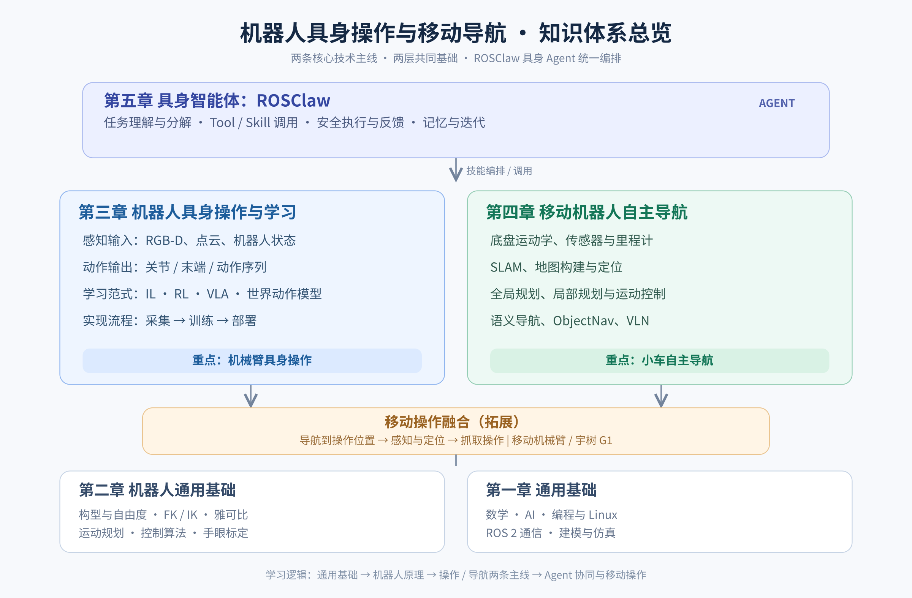

# 机器人具身操作与移动导航知识体系

本文旨在帮助新同学理清体系内容，认识各技术模块“做什么、为什么需要、与其他模块有什么联系”，具体细节部分需自行进一步学习。

# 第一章 通用基础

## 1.1 数学基础

机器人需要描述三维空间的位置、姿态和运动，因而应了解线性代数中的向量、矩阵、矩阵运算以及旋转矩阵、欧拉角、四元数和坐标变换。齐次变换把旋转与平移写在一个矩阵中：

$$
\mathbf{T} = \begin{bmatrix}\mathbf{R}&\mathbf{t}\\\mathbf{0}^{\mathsf{T}}&1\end{bmatrix}
$$

这类表示贯穿机器人运动学、相机标定、目标定位和导航。微积分中的导数、偏导数和梯度用于理解速度、加速度、控制及模型训练；优化中的损失函数、约束和最小二乘法则用于轨迹求解、状态估计和学习算法。概率统计的基本概念用于处理传感器噪声和环境不确定性，例如定位与多传感器融合。初期重在理解含义与使用场景，具体推导按研究需要补充。

## 1.2 AI 基础

应建立深度学习“数据输入—模型推理—损失计算—参数更新”的基本认知，了解神经网络、反向传播、Transformer 和 PyTorch 张量。理解大语言模型（LLM）与多模态大模型如视觉语言模型（VLM）的输入输出逻辑。

## 1.3 编程与开发环境

Python 是具身学习、视觉算法、数据处理和 ROS 2 上层开发的主要语言，重点掌握 NumPy、PyTorch、基础工程组织与调试；
Ubuntu/Linux 是常见机器人开发环境，应会使用终端、软件安装、环境变量、进程与设备权限、SSH；
C++ 常用于机器人底层实时运动控制；
Git 用于版本管理，虚拟环境与 Docker 用于管理复杂依赖。
这些能力直接决定是否能高效复现开源代码并定位系统问题。

## 1.4 ROS 2 通信与软件组织

ROS 2 是连接机器人各模块的通信与开发框架。相机、感知、规划、导航和控制可分别实现为节点：Topic 适合连续数据发布，Service 适合短时请求—响应，Action 适合需要进度反馈、取消与结果的长任务，例如导航到目标点或执行机械臂轨迹。TF2 管理不同坐标系随时间变化的关系；`rosbag2` 用于录制回放，RViz 2 用于查看坐标系、点云、路径和机器人状态。理解 ROS 2 的价值不只是会运行节点，更在于能看懂信息如何从传感器流向算法，再转化为机器人动作。

## 1.5 基础软件：建模与仿真

机器人模型描述了连杆、关节、自由度、碰撞形状与惯性等信息。URDF 是 ROS 生态常用模型格式，常与 RViz、MoveIt 2 和仿真器配合。MuJoCo 侧重多体动力学与接触仿真，适合机械臂操作、强化学习和腿式机器人控制；NVIDIA Isaac Sim 侧重高保真机器人场景、传感器和仿真集成，Isaac Lab 提供面向机器人学习的训练任务与工作流。Gazebo 与 ROS 2 集成紧密，在移动机器人导航和系统联调中也很常见。仿真可以提高开发效率，但摩擦、碰撞、视觉、控制延迟等与真实硬件存在差异，策略迁移时仍需考虑 Sim-to-Real 问题。

# 第二章 机器人通用基础

## 2.1 机器人构型、自由度与运动空间

机器人构型决定它能怎样运动。串联机械臂由关节和连杆连接而成，移动底盘依靠车轮改变位姿，人形机器人需要协调双腿、躯干和手臂。
自由度（DoF）是描述独立运动变量的数量；
关节空间描述关节角或关节位移，
任务空间则描述末端执行器的位置与姿态，
工作空间代表机器人可到达的区域。
理解这些概念是分析“机械臂能否抓到目标”“底盘要停在哪里”“G1 是否有足够操作空间”的前提。

## 2.2 正运动学与逆运动学

机器人运动学研究关节运动与机器人末端位置、姿态之间的几何关系，不考虑驱动力和力矩。机械臂往往有多个可以转动或移动的关节，因此需要将**关节空间**（每个关节的角度或位移）与**任务空间**（末端执行器的位置和姿态）联系起来。正运动学和逆运动学正是这两个空间之间的双向转换。

**正运动学（Forward Kinematics，FK）**回答的问题是：**已知各关节位置，机械臂末端现在在哪里、朝向哪里？** 例如，给定六轴机械臂的六个关节角，结合连杆长度、关节轴方向和机器人结构模型，可以逐级计算每个连杆的坐标变换，最终得到夹爪相对机器人基座的位姿。设关节变量为 $\mathbf{q} = [q_1,\ldots,q_n]^{\mathsf{T}}$，末端位姿可写为：
$$
{}^{\mathrm{base}}\!\mathbf{T}_{\mathrm{ee}}=\mathbf{T}_1(q_1)\mathbf{T}_2(q_2)\cdots\mathbf{T}_n(q_n)=f(\mathbf{q})
$$

其中 $\mathbf{T}_i$ 表示相邻连杆之间的齐次变换。工程中常利用 DH 参数法或 POE（指数积）法建立机械臂模型。正运动学是机器人状态显示、末端位置反馈、碰撞检测、坐标变换和运动规划的基础；它还可以回答“当前机器人姿态对应的实际末端位姿是什么”。

**逆运动学（Inverse Kinematics，IK）**回答的是相反的问题：**希望夹爪到达某个位置和姿态，各关节应该转到多少？** 例如，视觉系统估计出杯子的抓取位姿后，机械臂需要找到一组关节角，使夹爪能够以合适的方向接近杯子。数学上可表示为：
$$
\text{给定 }{}^{\mathrm{base}}\!\mathbf{T}_{\mathrm{ee}}^{*},\quad \text{求 }\mathbf{q}^{*}\text{，使 }f(\mathbf{q}^{*})={}^{\mathrm{base}}\!\mathbf{T}_{\mathrm{ee}}^{*}
$$

与正运动学通常可以直接计算不同，逆运动学可能**存在多个解、没有解，或者在奇异位置附近难以稳定求解**。例如，同一个末端位置可能对应“肘部抬起”和“肘部下垂”等不同姿态；目标太远、关节超限或被障碍阻挡时，即使能看到目标，也不一定能够完成抓取。因此，IK 不仅要考虑末端位姿误差，还要结合关节限位、当前关节状态及操作约束选择合适解。

常见逆运动学方法分为**解析法**和**数值法**。解析法利用机械臂几何结构直接推导关节解，速度快，但并非所有构型都容易获得解析解；数值法则从初始关节位置出发，反复计算位姿误差并更新关节角，可适用于更一般的机器人。数值法经常结合雅可比矩阵（见 2.3）以及阻尼最小二乘等方法。

可以用一次抓取理解二者的配合：**相机得到目标抓取位姿 → 通过坐标变换转换到机械臂基座 → 逆运动学求出候选关节目标 → 运动规划产生避障轨迹 → 控制器执行 → 正运动学根据实际关节反馈计算末端位姿**。需要注意，IK 只解决目标位姿对应的关节配置问题，并不负责寻找从起点到终点的无碰撞路径，这属于 2.4 运动规划的内容。

## 2.3 雅可比矩阵与速度运动学

雅可比矩阵描述关节速度与末端线速度、角速度之间的局部映射：

$$
\mathbf{v} = \mathbf{J}(\mathbf{q})\dot{\mathbf{q}}
$$

它是速度控制、视觉伺服、数值 IK 和力映射的重要工具。雅可比矩阵也能帮助判断机器人是否接近奇异位形：某些方向的末端运动可能要求很大的关节速度，因此操作规划不仅要考虑能否到达，还要考虑运动是否稳定、灵活。

## 2.4 运动规划、轨迹生成与碰撞规避

运动规划负责在起始状态和目标状态之间寻找可行路径，必须满足关节限位、障碍物和机器人自身碰撞等约束；轨迹生成进一步为路径赋予时间，限制速度、加速度及必要时的加加速度。机械臂常用 MoveIt 2 组织模型、规划场景、碰撞检测和轨迹执行。需要区分“规划出一条路”与“控制器实际执行成功”：真实系统仍会受标定误差、动态障碍和执行偏差影响。

## 2.5 机器人控制基础

机器人控制的作用，是根据**期望状态与实际反馈之间的误差**，持续计算执行器指令，使机械臂或移动底盘按照目标运动。可以把运动规划理解为“希望机器人怎样动”，控制理解为“如何让真实机器人尽量按计划动”。不同控制模式的主要区别，在于控制器接收的目标和最终作用于机器人执行器的量是什么。

### 2.5.1 位置控制

位置控制以关节角度、关节位移或末端位姿为目标，适用于移动到指定位置、机械臂取放等场景。最常见的闭环控制思想是根据位置误差调整输出。例如，关节位置的 PID 控制可以表示为：

$$
 e(t)=q_d(t)-q(t),\qquad
 u(t)=K_p e(t)+K_i\int_0^t e(\tau)\,d\tau+K_d\dot e(t)
$$

其中 $q_d$ 是目标关节位置，$q$ 是实际位置，$u$ 是控制输出。比例项纠正当前误差，积分项补偿长期偏差，微分项抑制快速变化。实际伺服驱动器通常包含更复杂的嵌套控制环，因此位置控制指令并不意味着外部程序必须自行编写 PID。位置控制易于使用，但在与刚性环境接触时，如果目标位置不合理，可能产生过大的接触力。

### 2.5.2 速度控制

速度控制指定关节角速度、末端线速度/角速度或移动底盘速度，适用于连续跟踪、视觉伺服和遥操作。例如相机持续观测目标偏差时，可以不断调整末端运动速度，使目标逐步对齐。关节速度与末端速度通过雅可比矩阵联系：

$$
\mathbf{v}=\mathbf{J}(\mathbf{q})\dot{\mathbf{q}}
$$

速度控制通常需要持续发送指令并结合反馈修正，特别关注控制频率、通信延迟、速度限幅和停止机制。对于移动机器人，导航控制器最终常会输出底盘线速度与角速度指令。

### 2.5.3 力矩控制

力矩控制直接将期望关节力矩作为控制目标，适合需要考虑机器人动力学、快速运动或精细接触的场景。机械臂的一种常见简化动力学模型为：

$$
M(\mathbf{q})\ddot{\mathbf{q}}+C(\mathbf{q},\dot{\mathbf{q}})\dot{\mathbf{q}}+g(\mathbf{q})=\boldsymbol{\tau}
$$

其中 $M$ 是惯性矩阵，$C$ 表示速度相关项，$g$ 为重力项，$\boldsymbol{\tau}$ 是关节力矩；此式暂不显式考虑摩擦和外力。力矩控制可以结合重力补偿、前馈和反馈实现更灵活的动态行为，但更依赖准确的模型、执行器能力和安全保护。并非所有商用机械臂都开放直接力矩控制接口。

### 2.5.4 力控制

力控制关注机器人与环境接触时施加的力是否符合期望，而不是只关注是否到达某个位置。例如擦拭桌面时需要维持适当的接触压力，抓取易碎物体时需要限制夹持力。基本思路是利用力/力矩传感器或其他力估计方式得到实际接触力，计算误差 $e_F=F_d-F$，再调整机器人动作或力矩输出。

对于沿接触法向的简单任务，可以将力误差经控制器转换为位置、速度或力矩修正。力控制通常依赖明确的接触方向、传感器反馈和稳定的控制周期。需要区分**力控制**与“给夹爪发送一个夹持力度参数”：后者在不同硬件上可能只是内部电流或夹持档位的近似控制。

### 2.5.5 阻抗控制与导纳控制

仅靠刚性位置控制，机器人遇到环境约束时可能持续“顶住”障碍。**阻抗控制（Impedance Control）**希望机器人表现得像具有一定弹簧、阻尼和惯性的机械系统，允许位置偏差与接触力之间形成可调的动态关系。任务空间的一种理想形式是：

$$
M_d\ddot{\mathbf{e}}+D_d\dot{\mathbf{e}}+K_d\mathbf{e}=\mathbf{F}_{\mathrm{ext}}
$$

其中 $\mathbf{e}$ 表示相对于平衡位姿的偏移，$M_d$、$D_d$、$K_d$ 分别表示期望惯性、阻尼和刚度，$\mathbf{F}_{\mathrm{ext}}$ 是外部作用力；具体正负号取决于误差和力的定义。直观上，刚度小意味着机器人更“软”，能够在接触力作用下让出一定空间。阻抗控制常用于装配、插孔、擦拭、人机交互等任务。

**导纳控制（Admittance Control）**从测得的外部力出发，计算机器人应该产生的运动响应，再由位置或速度控制器执行。二者都用于构建柔顺行为，但接口侧重点不同：阻抗控制通常强调“运动偏差与力的关系”，导纳控制通常强调“外力输入到运动指令的转换”。实际选择要结合机器人是否支持力矩接口、是否配备力传感器以及控制稳定性要求。

总体而言，**位置/速度控制**适合自由空间运动及轨迹跟踪，**力矩控制**更贴近机器人动力学和关节驱动，**力控制与阻抗/导纳控制**更适合接触丰富的操作。对于 IL、RL、VLA 等学习策略，还必须确认模型输出的是位置增量、速度、力矩还是动作片段，并配套正确的控制接口、控制频率、限幅和碰撞保护。上述模式并不互相排斥，实际机器人往往采用多层嵌套控制架构。

## 2.6 手眼标定与坐标系统一

视觉系统测量到的物体位置通常位于**相机坐标系**，但机械臂规划和控制一般基于**机械臂基座坐标系**或末端坐标系。如果不知道相机相对机器人安装在什么位置、朝向哪里，那么即使视觉模型准确识别出杯子，也无法正确指导夹爪去抓取。**手眼标定（Hand-Eye Calibration）**就是求出相机与机器人相关坐标系之间的固定刚体变换，使“相机看到的位置”能够转换成“机器人可执行的位置”。

首先需要区分**相机内参标定**和**手眼标定**。相机内参标定求焦距、主点、畸变等成像参数，帮助将像素与相机射线或三维坐标联系起来；手眼标定求的是相机与机器人之间的**外参**，即旋转和平移。这两类标定作用不同，视觉抓取通常需要将它们结合使用。

常见安装方式有两种。**眼在手上（Eye-in-Hand）**是将相机固定在机械臂腕部或末端，随机械臂一起运动，要求解相机相对末端的固定变换 ${}^{\mathrm{ee}}\mathbf{T}_{\mathrm{camera}}$；它适合近距离观察和跟随末端视角，但运动中相机位姿也会变化。**眼在手外（Eye-to-Hand）**是将相机固定在工作台或机器人外部，需要确定相机相对机械臂基座的变换 ${}^{\mathrm{base}}\mathbf{T}_{\mathrm{camera}}$；其视野往往更稳定，但可能受到遮挡。两种方式在变换链以及标定板的安装、运动方式上有所不同。

以眼在手上为例，假设标定板固定在环境中。机器人移动到多个关节姿态时，可以通过正运动学获得各时刻的末端位姿，同时通过相机观测标定板并估计标定板在相机坐标系中的位姿。因为相机和末端之间的安装关系固定，不同拍摄姿态之间会满足相应的坐标链约束。消去固定的标定板世界位姿后，可得到经典**手眼标定方程**：

$$
\mathbf{A}\mathbf{X}=\mathbf{X}\mathbf{B}
$$

其中 $\mathbf{X}$ 是待求的相机—末端固定变换，$\mathbf{A}$ 和 $\mathbf{B}$ 是由两次观测得到的机器人运动和相机相对运动；矩阵的具体方向取决于所采用的坐标约定。标定算法通过多组不同姿态下的运动数据估计 $\mathbf{X}$ 的旋转与平移。实际采样需要有足够丰富的旋转变化，而不是只在同一方向小幅平移，否则可能导致求解不稳定。

完成标定后，假设视觉系统已得到物体在相机坐标系下的位姿 ${}^{\mathrm{camera}}\mathbf{T}_{\mathrm{object}}$，则眼在手上的目标转换链为：

$$
{}^{\mathrm{base}}\mathbf{T}_{\mathrm{object}}
={}^{\mathrm{base}}\mathbf{T}_{\mathrm{ee}}\;{}^{\mathrm{ee}}\mathbf{T}_{\mathrm{camera}}\;{}^{\mathrm{camera}}\mathbf{T}_{\mathrm{object}}
$$

眼在手外则可写为：

$$
{}^{\mathrm{base}}\mathbf{T}_{\mathrm{object}}
={}^{\mathrm{base}}\mathbf{T}_{\mathrm{camera}}\;{}^{\mathrm{camera}}\mathbf{T}_{\mathrm{object}}
$$

这里采用“${}^{A}\mathbf{T}_{B}$ 将 $B$ 坐标系下的坐标转换到 $A$ 坐标系”的统一记法。得到目标物体在基座系下的位姿后，才能结合抓取位姿设计、IK 与运动规划完成操作。

标定结果的关键不是“算法输出了一个变换矩阵”，而是**转换后的实际位置是否准确**。需检查坐标系方向、单位（米/毫米）、时间戳、标定板位姿估计、机器人末端反馈和相机安装是否发生松动。可以将多个已知位置的点转换到基座坐标系进行验证；若误差随位置变化明显，应检查旋转估计、手眼数据同步和机器人自身标定。ROS 2 的 TF2 用于在运行中管理这些坐标变换，但 **TF2 只是存储和查询变换关系，不会自动完成手眼标定**。

# 第三章 机器人具身操作与学习

具身操作关注机器人如何根据环境观测完成抓取、放置、推动、开门等物理交互。传统方法通常显式设计感知、抓取规划与控制模块；学习型方法则利用示教或交互数据学习从观测到动作的映射。二者并非互斥，实际系统常结合几何约束、安全控制和学习策略。

## 3.1 输入：机器人能观察到什么

典型输入包括 RGB 图像、深度图（Depth）、点云、关节角与速度、末端位姿、夹爪状态，以及部分任务需要的触觉、力觉和语言指令。RGB 提供外观与语义信息，深度和点云提供几何与距离信息，本体状态告诉模型机器人当前处于什么姿态。不同算法对输入形式和坐标系要求不同，观测是否同步、是否完成标定，直接影响策略效果。

## 3.2 输出：机器人动作如何表达

操作模型可输出关节位置/速度、末端执行器位姿增量、夹爪开合，或一段连续动作序列（Action Chunk）。动作既可能在关节空间，也可能在末端任务空间；既可能是绝对目标，也可能是相对增量。输出形式决定了训练数据的标注方式、控制器接口和执行频率，因此研究论文中的“action”不能不加转换就直接发送给任意机械臂。部署时还需处理动作裁剪、坐标转换、平滑与安全约束。

## 3.3 典型学习范式

具身操作中的学习算法，核心问题是**机器人如何从视觉、本体状态和任务指令中形成可执行动作**。模仿学习（IL）、强化学习（RL）、视觉—语言—动作模型（VLA）与世界动作模型（WAM）是四类值得重点了解的路线。它们既存在训练方法的差异，也存在模型结构与学习目标的差异，并非严格互斥的四种分类：例如，VLA 或 WAM 都可能使用模仿学习数据进行训练，也可能结合强化学习进一步优化。

### 3.3.1 模仿学习（Imitation Learning，IL）

模仿学习的基本思路是**让机器人通过模仿专家示范学会操作**。研究人员利用遥操作设备、示教器或者已有专家策略，记录任务过程中的相机图像、机器人状态和专家动作，然后训练模型在相似观测下输出对应动作。最直接的方法是**行为克隆（Behavior Cloning，BC）**：

$$
\mathcal{L}_{\mathrm{BC}}=\mathbb{E}_{(o,a)\sim\mathcal{D}}\big[\|\pi_{\theta}(o)-a\|^2\big]
$$

其中 $o$ 是观测，$a$ 是专家动作，$\pi_{\theta}$ 是待学习的动作策略。对于不适合用简单平方误差建模的动作，实际训练也可能使用其他概率损失或生成式目标。

BC 容易理解和训练，但实际执行中如果机器人稍微偏离示范轨迹，就可能遇到训练数据没有覆盖的状态，产生**误差累积和分布偏移**。因此，示教质量、场景多样性以及失败恢复样本很重要。ACT（Action Chunking with Transformers）通过一次预测一段连续动作来提高操作连贯性；Diffusion Policy 使用扩散生成模型描述多模态动作分布，适合一个任务存在多种合理动作的情况。IL 是桌面抓取、放置、开抽屉等操作任务常用的学习起点。

### 3.3.2 强化学习（Reinforcement Learning，RL）

强化学习不是简单复现专家给出的正确动作，而是让机器人**通过与环境交互，在奖励信号的引导下学习策略**。每一步机器人观察状态、选择动作、得到新的环境状态和奖励，训练目标通常是最大化长期累计回报：

$$
J(\pi)=\mathbb{E}_{\pi}\left[\sum_{t=0}^{T}\gamma^t r_t\right]
$$

其中 $r_t$ 是每步奖励，$\gamma$ 是折扣因子。例如，机械臂抓取任务可以奖励成功抓起物体，同时惩罚碰撞和超限；灵巧操作则可以围绕物体目标姿态、接触稳定性等设计奖励。

RL 的优势在于能够探索人类示教中未必出现的动作，并针对特定目标优化控制策略；难点则在于奖励设计、交互样本消耗和训练稳定性。真实机械臂反复试错成本高、风险大，所以常先在 MuJoCo 或 Isaac Lab 等仿真环境中训练，再通过随机化、参数校准和微调缩小仿真与现实差距。实践中，RL 也可以在 IL 初始化的策略上进一步优化，并非必须从零开始学习。

### 3.3.3 视觉—语言—动作模型（Vision-Language-Action，VLA）

VLA 希望把视觉理解、语言任务和机器人动作预测整合到一个模型中。典型输入包含相机图像、自然语言指令以及可选的机器人本体状态，输出则是机器人关节动作、末端位姿增量或动作序列。例如输入“把红杯子放到盒子里”和当前桌面图像，模型可以预测完成该任务所需的操作动作。

可以将其抽象为：

$$
\mathbf{a}_{t:t+H}=\pi_{\theta}(o_t,\ell,s_t)
$$

其中 $o_t$ 是视觉观测，$\ell$ 是语言指令，$s_t$ 是机器人状态，$\mathbf{a}_{t:t+H}$ 是未来一段动作。部分 VLA 以预训练 VLM 为基础增加动作输出能力，再利用机器人轨迹数据训练或微调。动作可以被离散化为 token，也可以通过连续回归、扩散或 Flow Matching 等方式生成，具体取决于模型。

VLA 的研究目标是增强不同任务、物体和场景之间的迁移能力，但并不意味着模型能够直接适配任意机械臂：**动作空间、关节结构、相机布局、训练数据和控制频率**仍然可能存在较大差异。VLA 与高层 Agent 也要区分：VLA 主要负责从观测与指令生成机器人动作，Agent 更偏向任务拆解、多工具调用和跨技能决策。二者可以结合，由 Agent 选择技能或操作目标，再由 VLA 执行具体操作。

### 3.3.4 世界动作模型（World Action Model，WAM）

**这里的世界动作模型明确指能够直接输出机器人 Action 的模型**，而不是只生成未来图像、视频或世界状态的纯世界模型。它的核心想法是：让模型理解当前环境、可能发生的未来变化以及产生这些变化的机器人动作之间的关系，从而预测**与未来状态变化相对应的可执行动作**。

传统世界模型通常学习“给定当前状态和动作，未来世界会怎样变化”，可以写作 $\hat{s}_{t+1}=f_{\theta}(s_t,a_t)$；但仅有未来状态预测，并不足以直接驱动机器人。世界动作模型进一步将动作生成纳入模型，例如联合预测未来环境表征和动作序列：

$$
(\hat{z}_{t+1:t+H},\mathbf{a}_{t:t+H})
=F_{\theta}(o_t,\ell,s_t)
$$

其中 $\hat{z}$ 表示未来的视觉或世界状态表征，$\mathbf{a}$ 是直接用于后续机器人执行的动作输出。一些方法联合生成视频/视觉潜变量与动作，另一些方法先在内部预测未来再生成动作；**运行时不一定需要显式渲染完整未来视频**。所以不能简单理解为“先生成视频，再由另一个模块反推出动作”，更重要的是世界演化知识如何参与动作生成。

与主要依赖视觉语言理解来预测动作的 VLA 相比，WAM 更强调**动作与物理世界时序变化之间的一致性**，希望更好处理接触、遮挡、动作延迟和长时任务。但两类方法可能使用相似输入，甚至在架构与训练数据上相互融合，不能只凭是否包含语言或视频分辨模型类型。阅读具体论文时，应重点看它**预测什么、机器人 Action 是否直接输出、是否联合学习未来状态以及真实执行时的推理流程**。WAM 仍然是快速发展的研究路线，计算开销、数据需求和真机泛化表现需要依据具体方法评估。

## 3.4 应用流程：数据采集、训练与部署

学习型操作通常经历任务定义、数据采集、数据整理、模型训练、离线评估和真机部署。数据采集可通过遥操作、示教设备、已有机器人数据集或仿真生成完成，并记录图像、机器人状态、动作和时间戳。训练阶段需要确保输入输出的一致性，并通过独立测试场景评估效果。真机部署则关注观测延迟、推理速度、动作接口、碰撞风险与失败恢复。LeRobot 等开源生态提供数据格式、模型与训练工具，但具体适配仍需根据机器人硬件决定。

# 第四章 移动机器人自主导航

导航的目标是使机器人在环境中了解自身位置、规划到目标点的路线，并在执行过程中躲避障碍和处理定位偏差。可将其理解为“建图—定位—规划—控制”的系统闭环，ROS 2 生态中的 Nav2 是常见工程框架。

## 4.1 底盘运动学、传感器与里程计

差速、全向与阿克曼底盘具有不同的运动约束，影响路径能否直接跟随。轮编码器可估计里程计（Odometry），IMU 提供角速度和加速度信息，激光雷达与相机感知周围环境。里程计能够提供连续的相对运动估计，但误差会随时间累积，因此需要与外部环境观测结合。理解底盘模型与传感器特性，是调试导航控制和定位算法的基础。

## 4.2 SLAM 与地图表示

SLAM（同时定位与建图）研究机器人在未知环境中一边估计自身运动，一边构建地图。常见方法包括激光 SLAM 和视觉 SLAM；地图形式可以是二维栅格、三维点云、稀疏特征地图或带有语义信息的地图。二维室内移动机器人通常依赖占据栅格地图进行规划，而操作和高层语义任务可能需要额外的三维或语义信息。SLAM 的重点不是单纯“画出地图”，还包括限制累计漂移并维持地图与机器人位姿的一致性。

## 4.3 定位与多传感器融合

有地图后，机器人仍需估计自己在地图中的实时位置。定位方法可结合激光匹配、粒子滤波（如 AMCL）、视觉观测和里程计；EKF 等滤波方法常用于融合 IMU、轮式里程计等状态信息。定位系统需要正确处理 `map`、`odom` 与 `base_link` 等坐标系之间的关系。定位不可靠时，即便规划算法正确，小车也难以准确到达目标，更无法为后续机械臂抓取提供稳定的操作位置。

## 4.4 全局规划、局部规划与运动控制

全局规划根据地图计算从起点到目标点的整体路线，常见思路包括 A* 和 Dijkstra 等搜索算法；局部规划或控制则结合实时障碍信息与底盘约束产生可执行速度指令。Nav2 提供规划器、控制器、代价地图、行为树和恢复行为等模块，便于构建完整的导航系统。需要理解全局路径不等于最终行驶轨迹：机器人必须在持续感知和反馈中修正运动，应对临时障碍、定位误差和目标附近的精细停靠。

## 4.5 语义导航、ObjectNav 与 VLN

传统导航通常接收明确的坐标目标；语义导航则将“去会议室”“找到冰箱”这类语义目标与地图、视觉感知和路径规划结合。ObjectNav 强调寻找指定物体类别或实例，VLN（Vision-Language Navigation）强调依据语言描述和视觉观测完成导航。它们使机器人不再完全依赖人工给定精确坐标，但会增加语言歧义、目标检测与场景理解等难点。对于移动操作而言，这些技术能帮助机器人先找到可能存在目标物体的区域，再交由操作系统完成近距离定位与抓取。

# 第五章 具身智能体：ROSClaw

## 5.1 从机器人功能到具身 Agent

传统机器人系统通常由开发者事先定义较固定的操作流程，例如“导航到坐标 A，执行抓取，然后返回”。具身 Agent 进一步面向自然语言或更抽象的任务目标，利用 LLM/VLM 解析用户意图、分解任务、选择能力并根据执行反馈调整后续步骤。Agent 不应取代运动学、Nav2 或底层控制器，而应在这些经过验证的能力之上进行任务级决策与组织。

## 5.2 ROSClaw 的定位与整体思路

ROSClaw (https://github.com/ros-claw/rosclaw) 可作为连接 Agent 与 ROS 机器人能力的中间层，重点关注“模型提出的动作意图怎样变成可控、可追踪的物理执行”。在这一架构中，高层 Agent 决定做什么，ROSClaw 负责能力接入、执行边界和反馈组织，底层 ROS 2、Nav2、机械臂控制及感知模块负责具体动作。它的意义在于避免让语言模型直接向执行器输出不受约束的控制命令，并降低不同机器人功能对 Agent 的耦合。

## 5.3 能力封装、任务规划与工具调用

一个机器人能力应具有清楚的输入、前置条件、执行接口和返回状态。例如 `navigate_to` 接收目标位置并返回导航结果，`pick_object` 需要目标物体及相关感知信息。Agent 可以通过工具调用、结构化参数或 MCP 等机制选择和组织这些能力；ROSClaw 再将请求映射到符合权限和约束的机器人动作。对于课题组而言，这一思路可以把“机械臂操作”与“小车导航”先作为相对独立的能力模块，再在任务层组合，而不必一开始就开发复杂的端到端移动操作模型。

## 5.4 执行验证、安全边界与反馈

机器人动作发生在物理世界，因而不能只依据语言模型回复“已完成”来判断任务成功。系统应区分动作请求、动作被接受、执行中、执行结束以及任务是否真正达成。ROSClaw 重点强调授权、安全执行、动作记录和执行回执（Receipt）等机制，使结果能够被检查和追溯。底层仍需设置碰撞检测、速度限制、急停与硬件安全约束。对于 Agent 而言，真实执行反馈是决定重试、重新规划或报告失败的必要依据。

## 5.5 记忆、技能复用与系统演进

一次成功的动作调用并不等于机器人形成了可复用的技能。更有价值的系统能够记录操作条件、执行结果和失败原因，并将经过验证的流程沉淀为技能或经验，在类似任务中复用。这里的“记忆”可以包括任务日志、环境语义信息和技能元数据，不意味着模型自动完成参数训练。ROSClaw 将执行验证、经验积累与技能演进联系起来，为后续研究更可靠的具身 Agent 提供组织框架。

# 结语：五章之间的关系

通用基础提供数学、AI、编程与 ROS 2 工具；机器人通用基础解释机器人如何表示和执行动作；具身操作与学习解决“看见目标后怎样操作”；自主导航解决“机器人怎样自主到达目标附近”；ROSClaw 则组织这些能力，让自然语言任务通过安全、可反馈的机器人技能完成。

我们围绕操作与导航两条技术主线，逐步扩展为移动操作与具身 Agent 系统。

## 相关链接

- ROS 2 官方文档：https://docs.ros.org/
- MoveIt 2：https://moveit.picknik.ai/
- Nav2：https://docs.nav2.org/
- MuJoCo：https://mujoco.org/
- Isaac Sim：https://developer.nvidia.com/isaac/sim
- Isaac Lab：https://isaac-sim.github.io/IsaacLab/
- LeRobot：https://github.com/huggingface/lerobot
- ROSClaw：https://github.com/ros-claw/rosclaw
